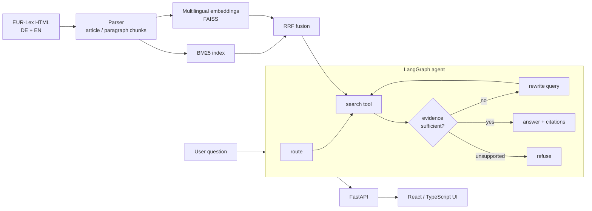

# NormNavigator

[](https://github.com/kartikpadayachi14/normnavigator/actions/workflows/ci.yml)

Bilingual (German/English) agentic RAG assistant for EU product regulations
(Machinery Regulation 2023/1230, AI Act 2024/1689, General Product Safety Regulation 2023/988),
with a measured retrieval and answer-quality evaluation.

> Status: **Milestone 1 done (parser + corpus, 2134 chunks); Milestone 2 (retrieval + evaluation) next.** See [ENGINEERING_LOG.md](ENGINEERING_LOG.md).

## Architecture (target)



## Setup

```bash
python -m venv .venv && source .venv/bin/activate
pip install -r requirements-dev.txt
cp .env.example .env   # fill in values; never commit .env
pytest -q
```

## Results

| metric | value | test-set size | baseline | source file | tag |
|---|---|---|---|---|---|
| hit@5 (hybrid RRF) | NOT MEASURED | — | BM25-only, vector-only | results/retrieval_eval.json | [PLANNED] |
| MRR (hybrid RRF) | NOT MEASURED | — | BM25-only, vector-only | results/retrieval_eval.json | [PLANNED] |
| faithfulness (agent) | NOT MEASURED | — | single-shot RAG | results/answer_eval.json | [PLANNED] |
| latency p50 / p95 | NOT MEASURED | — | — | results/latency.json | [PLANNED] |

## Data and licence

Regulation texts come from EUR-Lex. Reuse of EU legal texts is permitted with attribution
(Commission Decision 2011/833/EU). Raw files are not committed; `scripts/` will download them.
